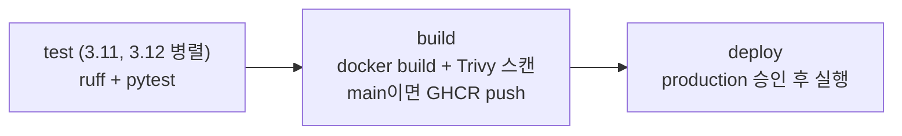

# 04. CI/CD — GitHub Actions & Jenkins

## 1. 로컬에서 CI 단계 그대로 실행

```bash
pip install -r requirements.txt pytest httpx ruff
ruff check .        # Lint
pytest -q           # Test
docker build -t cart-api .   # Build (Docker Desktop 필요)
```

로컬에서 통과하면 CI에서도 통과합니다. **CI는 이 명령들을 매번 자동으로 실행해주는 것**입니다.

## 2. GitHub Actions에 올리기 (공개 저장소 무료)

1. GitHub에 새 저장소를 만들고 이 폴더(`04_cicd`)의 내용을 루트로 push
2. `github-workflow/ci-cd.yml` → **`.github/workflows/ci-cd.yml`** 로 이동
3. push 하면 **Actions** 탭에서 실행 과정 확인



### 일부러 실패시켜 보기

- `app/main.py`의 `SHIPPING_FEE = 3_000`을 `2_000`으로 바꿔 push → **test 단계 빨간불**, build·deploy는 실행되지 않음
- PR을 만들면 PR 화면에 체크 결과가 표시됨 → Branch protection에서 "CI 통과 필수"로 설정하면 merge 차단

### 운영 배포 승인 설정

Settings → Environments → `production` 생성 → **Required reviewers**에 본인 추가 → deploy Job이 승인 대기 상태가 됨

## 3. Jenkins (선택, Docker로 로컬 실행)

```bash
docker run -d --name jenkins -p 8080:8080 -v jenkins_home:/var/jenkins_home jenkins/jenkins:lts
docker exec jenkins cat /var/jenkins_home/secrets/initialAdminPassword   # 초기 비밀번호
```

http://localhost:8080 → 추천 플러그인 설치 → **New Item → Pipeline** → "Pipeline script from SCM"으로 저장소 지정 → `Jenkinsfile` 실행

> Jenkins 컨테이너 안에는 python3·docker가 없으므로 실제로 빌드하려면 에이전트 설정이 필요합니다. 처음에는 **Jenkinsfile의 구조(stage, when, input, credentials)를 GitHub Actions YAML과 비교**하는 것을 목표로 하세요.

## 파일

| 파일 | 내용 |
|---|---|
| `app/main.py`, `tests/` | 장바구니 금액 API와 테스트 |
| `Dockerfile` | non-root 실행 이미지 |
| `github-workflow/ci-cd.yml` | matrix 테스트, needs 의존성, 최소 권한 `permissions`, Trivy 스캔, GHCR push, environment 승인 |
| `Jenkinsfile` | 같은 흐름의 Jenkins 선언형 파이프라인 |
